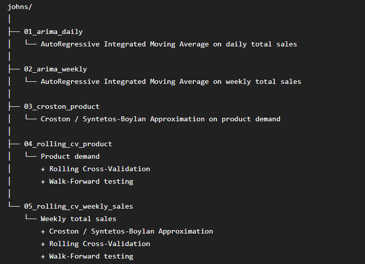

# Statistical Models — Demand Forecasting & Early-Warning Lab

A working notebook lab for **sales and product-demand forecasting** built on real Odoo/PostgreSQL
sales data for **Johns** (Kozhikode, Kerala, India), enriched with **Open-Meteo** weather data.

The repository is organised as a progression: it starts from textbook ARIMA, moves through
intermittent-demand and cross-validated SKU models, then into weather- and business-calendar-aware
ARIMAX/SARIMAX, and finally into two "Pipeline 2" early-warning prototypes (Isolation Forest and
LightGBM).



---

## Contents

| Folder | What it is | Key notebook |
|---|---|---|
| [01_arima_intro/](01_arima_intro/) | ARIMA fundamentals — p/d/q, ACF/PACF, auto-ARIMA, residual diagnostics, SARIMA/SARIMAX | [arima-model-for-time-series-forecasting.ipynb](01_arima_intro/arima-model-for-time-series-forecasting.ipynb), [practical_arima_forecasting.ipynb](01_arima_intro/practical_arima_forecasting.ipynb) |
| [02_arimax_weather/](02_arimax_weather/) | First end-to-end ARIMA vs ARIMAX with downloaded weather as an exogenous regressor | [arimax_weather_complete_notebook.ipynb](02_arimax_weather/arimax_weather_complete_notebook.ipynb) |
| [weather_api/](weather_api/) | Open-Meteo archive client + Kozhikode rainfall exploration | [weather.py](weather_api/weather.py), [rainfall_explorer.ipynb](weather_api/rainfall_explorer.ipynb) |
| [johns/input/](johns/input/) | Exported Odoo data: daily sales, weekly sales, weekly SKU demand | — |
| [johns/01_arima_daily/](johns/01_arima_daily/) | Daily total-sales ARIMA with naive baselines + walk-forward validation, 30-day forecast | [odoo_arima_daily_sales_forecasting.ipynb](johns/01_arima_daily/odoo_arima_daily_sales_forecasting.ipynb) |
| [johns/02_arima_weekly/](johns/02_arima_weekly/) | Weekly aggregation, log-ARIMA variant, 12-week forecast | [odoo_weekly_sales_arima_forecasting.ipynb](johns/02_arima_weekly/odoo_weekly_sales_arima_forecasting.ipynb) |
| [johns/03_croston_product/](johns/03_croston_product/) | Per-SKU intermittent demand — Croston & Syntetos-Boylan Approximation with alpha tuning | [odoo_product_demand_croston_forecasting.ipynb](johns/03_croston_product/odoo_product_demand_croston_forecasting.ipynb) |
| [johns/04_rolling_cv_product/](johns/04_rolling_cv_product/) | Same SKU problem with rolling time-series cross-validation for model/parameter selection | [odoo_product_demand_rolling_cv_forecasting.ipynb](johns/04_rolling_cv_product/odoo_product_demand_rolling_cv_forecasting.ipynb) |
| [johns/05_rolling_cv_weekly_sales/](johns/05_rolling_cv_weekly_sales/) | Rolling CV + walk-forward applied to weekly total sales | [odoo_weekly_sales_croston_rolling_cv_forecasting.ipynb](johns/05_rolling_cv_weekly_sales/odoo_weekly_sales_croston_rolling_cv_forecasting.ipynb) |
| [johns/06_arimax_sarimax_sales/](johns/06_arimax_sarimax_sales/) | ARIMA / ARIMAX / SARIMA / SARIMAX on daily **and** weekly sales with Open-Meteo rainfall | [06_arimax_sarimax_daily_weekly_rainfall.ipynb](johns/06_arimax_sarimax_sales/06_arimax_sarimax_daily_weekly_rainfall.ipynb) |
| [johns/07_arimax_sarima_business_aware/](johns/07_arimax_sarima_business_aware/) | Adds a **business calendar** (working days, month-end, holidays) and **lagged rain**; daily, weekly and monthly | [07_business_aware_arimax_sarimax_daily_weekly.ipynb](johns/07_arimax_sarima_business_aware/07_business_aware_arimax_sarimax_daily_weekly.ipynb) |
| [johns/08_demand_surge_warning/](johns/08_demand_surge_warning/) | **Pipeline 2a** — seasonally conditioned Isolation Forest that flags unusual upcoming 7/14-day rainfall windows | [08_pipeline2_isolation_forest_weather_surge_demo.ipynb](johns/08_demand_surge_warning/08_pipeline2_isolation_forest_weather_surge_demo.ipynb) |
| [johns/09_lightGBM/](johns/09_lightGBM/) | **Pipeline 2b** — LightGBM classifier on a *semi-synthetic* history predicting an unusual-order event at 7/14/21-day horizons | [09_johns_pipeline2_lightgbm_semisynthetic_unusual_order_demo.ipynb](johns/09_lightGBM/09_johns_pipeline2_lightgbm_semisynthetic_unusual_order_demo.ipynb) |

Every folder keeps its own exported `.csv` results, and where applicable a serialised model
(`.pkl` / `.joblib`) so a notebook's conclusions can be inspected without re-running it.

---

## Data

### 1. Sales — Odoo / PostgreSQL

Each `johns/` notebook opens with the exact PostgreSQL query used to produce its input CSV. The
common rules across all exports:

- confirmed orders only (`sale_order.state IN ('sale', 'done')`)
- Odoo UTC timestamps converted to `Asia/Kolkata`
- a generated date spine so genuine no-sales days become `0` rather than missing rows
- only **complete** Monday–Sunday weeks; future-dated rows excluded
- SKU-level exports use `product_uom_qty`, exclude section/note lines and non-positive quantities

| File | Grain | Columns | Coverage |
|---|---|---|---|
| [johns_daily_sales.csv](johns/input/johns_daily_sales.csv) | day | `sale_date`, `daily_sales_total` | 2025-01-06 → 2026-08-07 |
| [johns_weekly_sales.csv](johns/input/johns_weekly_sales.csv) | week ending Sunday | `week_ending`, `weekly_sales_total` | same range, complete weeks |
| [weekly_product_demand.csv](johns/input/weekly_product_demand.csv) | week × SKU × UoM | `week_ending`, `product_id`, `default_code`, `uom_id`, `weekly_demand_qty`, `order_count` | ~6k rows |

To refresh: run the query printed in the notebook against the Odoo database and export the result
to the corresponding path under `johns/input/`.

### 2. Weather — Open-Meteo

Rainfall and temperature are pulled live from the free Open-Meteo APIs (no API key required):

- `https://archive-api.open-meteo.com/v1/archive` — historical daily reanalysis
- `https://api.open-meteo.com/v1/forecast` — short-horizon forecast, used to score live risk
- `https://geocoding-api.open-meteo.com/v1/search` — city name to latitude/longitude

Default location is **Kozhikode, Kerala, India** (approx. 11.248 N, 75.780 E, `Asia/Kolkata`).
[weather.py](weather_api/weather.py) is the minimal standalone fetcher; the notebooks embed their
own fetch cells so each one is self-contained.

---

## Modelling approach

**Baselines are always included.** Every notebook scores naive (last value), rolling mean and
rolling median baselines alongside the statistical models. A model only counts as useful if it
beats these.

**Metrics.** MAE, RMSE and WAPE (weighted absolute percentage error). WAPE is the primary metric —
it is robust to the zero-sales days that break MAPE.

**Validation.** Chronological splits only, never random. Later notebooks use rolling time-series
cross-validation to select the model and its parameters, then a walk-forward evaluation on an
untouched final test block.

**Exogenous variables** (`06`, `07`) are scaled on the training fold only, and restricted to values
that would genuinely be known at prediction time — a rainfall *forecast*, not a rainfall
*observation*, and calendar features known in advance.

---

## Results snapshot

WAPE on the untouched final test period, lower is better. These are the exported comparison CSVs,
not hand-picked runs.

**Daily total sales** ([06](johns/06_arimax_sarimax_sales/johns_daily_arimax_sarimax_comparison.csv), [07](johns/07_arimax_sarima_business_aware/johns_daily_business_aware_model_comparison.csv))

| Model | WAPE |
|---|---|
| ARIMA | 100.8 |
| SARIMA | 101.0 |
| 7-Day Median (baseline) | 101.7 |
| Naive | 118.1 |
| ARIMAX + Rainfall | 127.5 |
| SARIMAX + Business + Lagged Rain | 149.4 |

**Weekly total sales** ([05](johns/05_rolling_cv_weekly_sales/weekly_sales_model_comparison.csv), [07](johns/07_arimax_sarima_business_aware/johns_weekly_business_aware_model_comparison.csv))

| Model | WAPE |
|---|---|
| Rolling CV + Walk-Forward SBA | **68.6** |
| ARIMAX + Business Calendar | 77.3 |
| 4-Week Median (baseline) | 78.1 |
| ARIMA | 83.1 |
| Naive | 94.0 |
| SARIMAX + Business + Lagged Rain | 438.5 |

### What the numbers actually say

- **Daily sales are close to unforecastable from history alone.** Every model sits at roughly
  100% WAPE — no better than predicting the median. The series is spiky and dominated by a small
  number of large B2B orders; there is no daily signal for ARIMA to lock onto.
- **Weekly aggregation helps.** The Croston/SBA family with rolling CV is the only configuration
  that clearly beats the 4-week median baseline (68.6 vs 78.1 WAPE).
- **Rainfall as a plain exogenous regressor did not help.** ARIMAX/SARIMAX with rainfall are
  consistently *worse* than plain ARIMA here. The business-calendar variant helps slightly at the
  weekly grain and hurts at the daily grain.
- **Seasonal SARIMAX at the weekly grain is unstable** (WAPE in the hundreds) — the history is under
  two years, too short for a reliable weekly seasonal component. The notebooks flag this explicitly
  rather than reporting the number silently.

This negative result is what motivates folders `08` and `09`: if the *level* of demand cannot be
predicted well, the more useful question is **when an unusual demand event is likely**, framed as
anomaly detection and classification rather than regression.

---

## Pipeline 2 — early-warning prototypes

### 08 · Isolation Forest weather-surge warning

Builds sliding 7- and 14-day rainfall windows over a long historical archive, engineers window
features (total rain, max daily rain, rainy days, very-wet days), then fits a **seasonally
conditioned** Isolation Forest — a window is compared against historical windows from the same
season, so a wet week in monsoon is not flagged simply for being wet.

The live forecast window is scored into an anomaly percentile and mapped to a `LOW / MEDIUM / HIGH`
management-facing label, explained against seasonal P50/P75/P90/P95/P99 reference levels. Includes a
what-if simulation for demoing stronger rainfall scenarios, plus an optional experiment associating
historical weather anomalies with same-week / next-week / two-week-later sales surges.

Latest exported run ([johns_pipeline2_live_weather_risk.csv](johns/08_demand_surge_warning/johns_pipeline2_live_weather_risk.csv)):

| Horizon | Window | Rain total | Anomaly pct | Risk |
|---|---|---|---|---|
| 7 d | 2026-08-17 → 08-23 | 16.4 mm | 51.7 | LOW |
| 14 d | 2026-08-17 → 08-30 | 29.0 mm | 88.8 | MEDIUM |

### 09 · LightGBM unusual-order classifier — semi-synthetic

> **This is a demonstration model, not a validated real-world probability.** The label it predicts is
> *injected by the notebook itself*. It shows the architecture of a weather-to-unusual-order early
> warning system; it does not establish that such a relationship exists in Johns' real data.

Real Johns sales cover roughly 19 months — far too short to learn a rare-event classifier. So the
notebook learns a compact template from the real series (month effects, weekday effects, residual
characteristics), generates a **10-year semi-synthetic history** (2016-08-25 → 2026-08-24) that
preserves that shape, then transparently injects unusual-order events using a documented
weather-pressure rule (trigger probability, cooldown, delay — all recorded in
[README_SYNTHETIC_DEMO_METADATA.json](johns/09_lightGBM/johns_lightgbm_demo_outputs/README_SYNTHETIC_DEMO_METADATA.json)).

LightGBM binary classifiers are then trained per horizon on sales-history, observed-weather,
forecast-style-weather and calendar features, with a chronological train/validation/test split and a
threshold search on validation.

Test-set performance ([johns_lightgbm_demo_metrics.csv](johns/09_lightGBM/johns_lightgbm_demo_outputs/johns_lightgbm_demo_metrics.csv)):

| Horizon | Threshold | Precision | Recall | F1 | ROC AUC | Baseline F1 |
|---|---|---|---|---|---|---|
| 7 d | 0.535 | 0.465 | 0.317 | 0.377 | 0.737 | 0.182 |
| 14 d | 0.700 | 0.829 | 0.234 | 0.365 | 0.746 | 0.340 |
| 21 d | 0.385 | 0.708 | 0.468 | 0.563 | 0.734 | 0.353 |

The final section scores a live Open-Meteo forecast through the trained models. The 21-day live row
is skipped when the forecast API does not extend far enough ahead.

---

## Getting started

```powershell
# Windows / PowerShell
python -m venv .venv
.\.venv\Scripts\Activate.ps1

pip install pandas numpy matplotlib scipy statsmodels pmdarima scikit-learn lightgbm joblib requests jupyter
jupyter lab
```

A `.venv` is already present in the repo (Python 3.13) with the set actually used: pandas 3.0.5,
numpy 2.5.1, statsmodels 0.14.6, pmdarima 2.1.1, scikit-learn 1.9.0, lightgbm 4.7.0,
matplotlib 3.11.1, scipy 1.18.0, joblib 1.5.3, requests 2.34.2.

**Suggested reading order:** `01` → `02` → `johns/01` → `johns/02` → `johns/03` → `johns/04` →
`johns/05` → `johns/06` → `johns/07` → `johns/08` → `johns/09`. Each notebook is self-contained and
runs top-to-bottom; the only external requirements are the input CSVs and internet access for
Open-Meteo.

---

## Conventions

- **Notebooks are the unit of work.** One folder per experiment, numbered in the order it was built,
  containing the notebook plus its exported artefacts.
- **Everything is exported.** Comparison tables, per-fold CV results, forecasts, feature importances
  and largest-error analyses are all written to CSV next to the notebook.
- **No look-ahead.** Chronological splits, training-fold-only scaling, and exogenous features
  restricted to what is knowable at prediction time.
- **Baselines and negative results are reported, not hidden.** Several notebooks conclude that the
  more complex model lost.

## Repository notes

- `.venv/` and the `*.zip` Odoo database dumps are large local artefacts, not meaningful history —
  they should be covered by `.gitignore`.
- The loose `*.pdf` files at the repo root and in [johns/07_arimax_sarima_business_aware/](johns/07_arimax_sarima_business_aware/)
  (proforma invoices, RFQs, packing lists) are sample Odoo document exports from validating the data
  pipeline, not model inputs.
